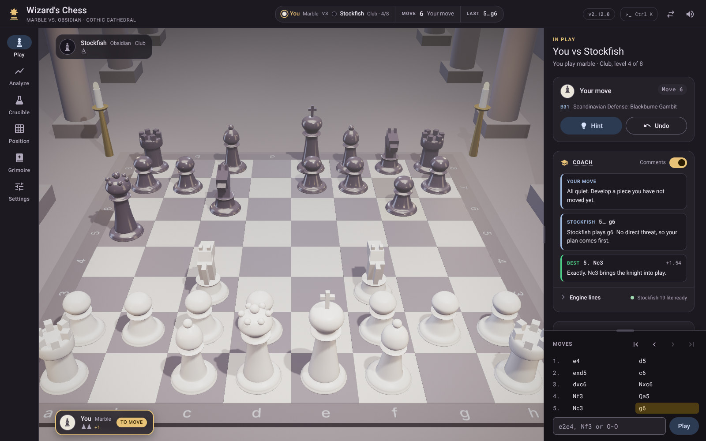
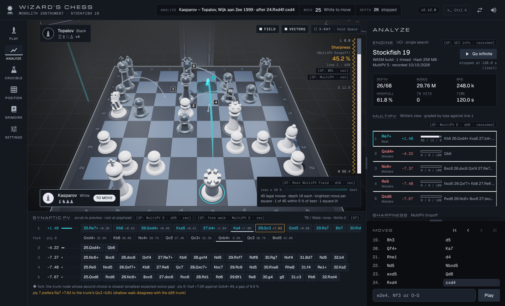
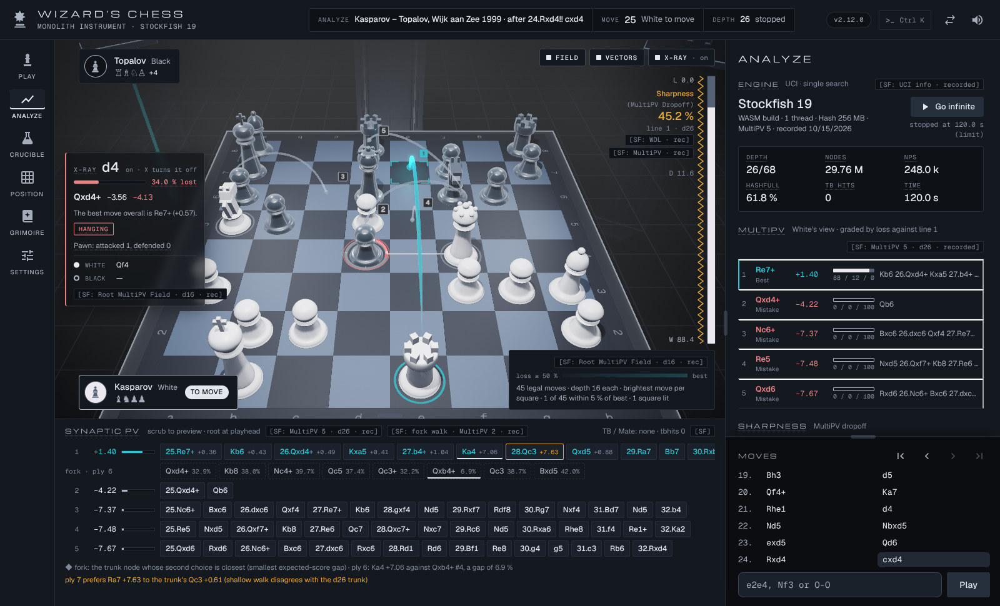
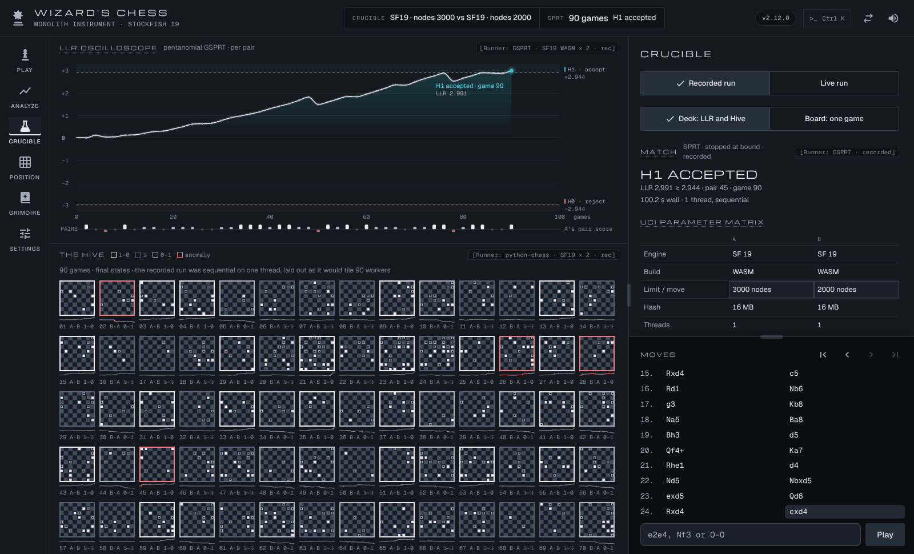
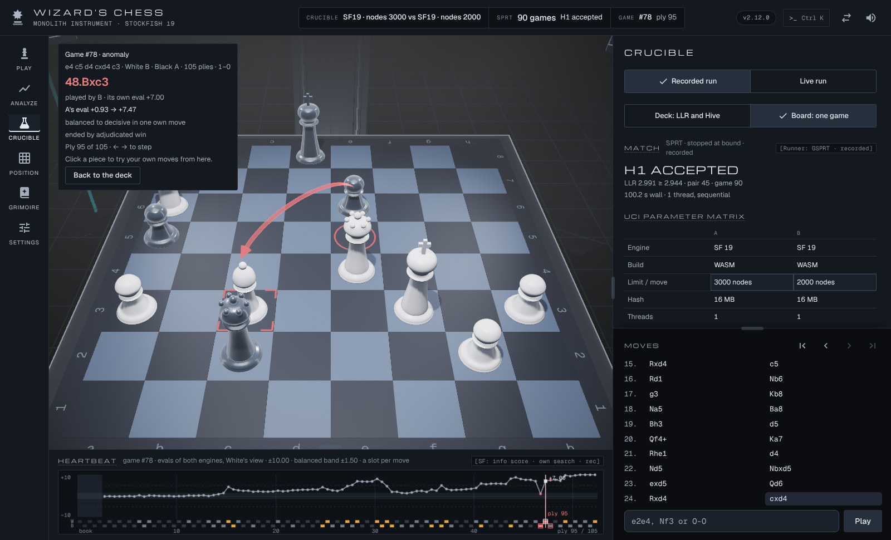
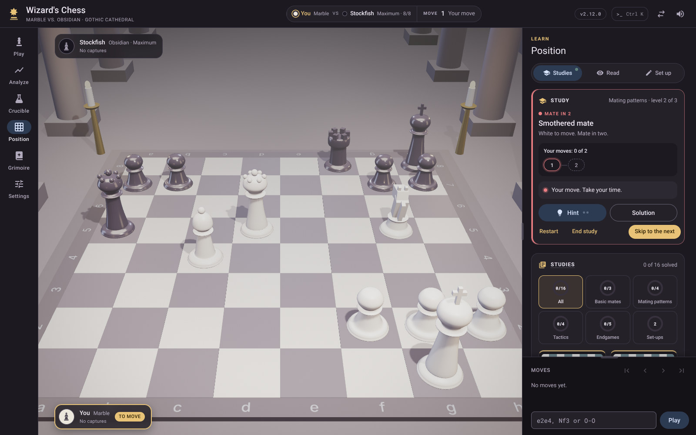
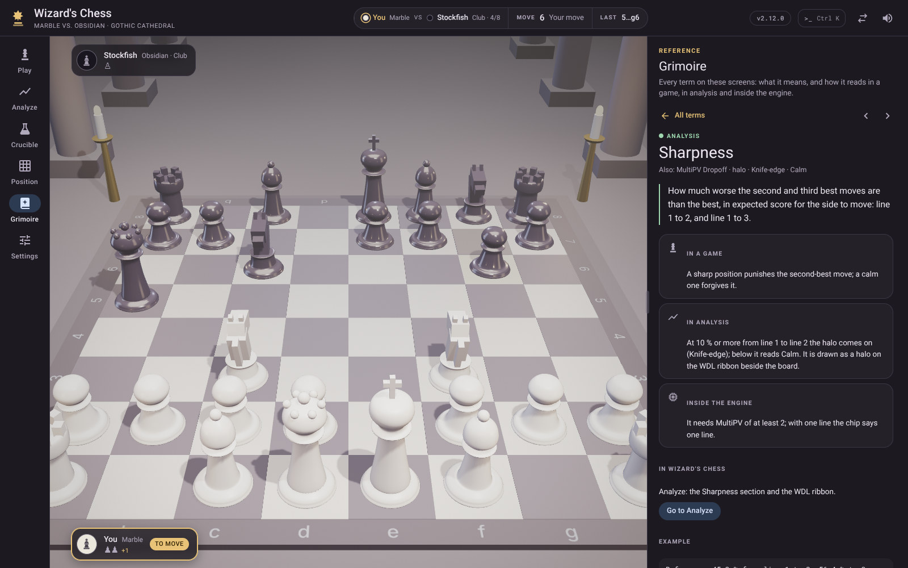
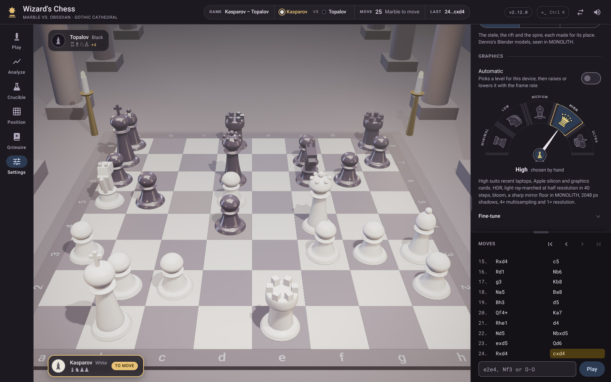

<!--
✒ Metadata
    - Title: MONOLITH (digiSpace Edition - v1.8)
    - File Name: README.md
    - Relative Path: README.md
    - Artifact Type: docs
    - Version: 1.8.0
    - Date: 10/30/2026
    - Update: Friday, October 30, 2026
    - Author: Dennis 'dendogg' Smaltz
    - A.I. Acknowledgement: Anthropic - Claude Opus 5.5
    - Signature: ︻デ═─── ✦ ✦ ✦ | Aim Twice, Shoot Once!

✒ Changelog:
    - 1.8.0 (10/30/2026) [dendogg + Anthropic - Claude Opus 5.5] — 2.18.0:
      the free board, PGN, draws, Settings' five cards, keys and palette
      words, Who plays it, phones and touch; the cathedral drops "Gothic".
    - 1.7.0 (10/26/2026) [dendogg + Anthropic - Claude Opus 5.5] — 2.17.0:
      the Conical M Dennis made MONOLITH's official mark heads the app bar
      as the logo and opens the page as the emblem. The loading screen's
      paragraph says so, the folder lists both marks and the brand system
      in assets/, the documents list assets/README.md and the system's
      own, and the tools say what tools/build-emblem.mjs writes and where
      the marks come from.
    - 1.6.1 (10/24/2026) [dendogg + Anthropic - Claude Opus 5.5] — The
      folder and the tools carry the game's 3D pieces as .blend files, which
      Dennis asked for, and tools/build-piece-models.py, the Blender script
      that builds them.
    - 1.6.0 (10/24/2026) [dendogg + Anthropic - Claude Opus 5.5] — The
      loading screen's paragraph follows 2.16.0: its meter, its tips and the
      settings it follows; js/data/ lists the tips.
    - 1.5.0 (10/24/2026) [dendogg + Anthropic - Claude Opus 5.5] — 2.15.0:
      the loading screen is animated and the meter follows Dennis's version
      1.2 drawing; the pillar models moved to assets/models/, which the
      folder, the documents and the tools now name.
    - 1.4.0 (10/24/2026) [dendogg + Anthropic - Claude Opus 5.5] — 2.14.0:
      the page opens on Dennis's emblem, in the world it opens in. The
      worlds section says so, the folder lists the emblem in assets/, and
      the tools list tools/build-emblem.mjs.
    - 1.3.3 (10/24/2026) [dendogg + Anthropic - Claude Opus 5.5] — Dennis
      renamed the app MONOLITH. The title, the description, the current
      release (2.13.0), the folder in the tree and the licence line say so,
      and the second world is the MONOLITH world where the two could be
      confused.
    - 1.3.2 (10/23/2026) [dendogg + Anthropic - Claude Opus 5.5] — Dennis
      chose to publish the calibration kit; its files were copies or older
      versions of the project's own, so its guide became CALIBRATION.md,
      listed with the documents, and the folder no longer shows a kit in
      engine/.
    - 1.3.1 (10/23/2026) [dendogg + Anthropic - Claude Opus 5.5] — Dennis
      chose the MIT License for the project's own files: use it freely, keep
      his name and the notice with it, no warranty. Credits and licences say
      so, and the folder lists LICENSE.
    - 1.3.0 (10/23/2026) [dendogg + Anthropic - Claude Opus 5.5] — The
      front door for the public repository Dennis is preparing (2.12.0):
      screenshots of the app, what it needs to run, how to publish it on
      GitHub Pages, the repository's own files, and the licences, with the
      engine's source location.
    - 1.2.0 (10/23/2026) [dendogg + Anthropic - Claude Opus 5.5] — 2.11.0:
      the levels are chosen on Dennis's graphics meter.
    - 1.1.0 (10/23/2026) [dendogg + Anthropic - Claude Opus 5.5] — The
      graphics placeholder filled in now that 2.10.0 ships Dennis's five
      graphics levels; GRAPHICS.md added to the documents.
    - 1.0.0 (10/23/2026) [dendogg + Anthropic - Claude Opus 5.5] — First
      release, written at Dennis's request while 2.10.0 was in progress:
      what the app is, how to run it, what each destination does, and
      where everything lives. The graphics section is a marked placeholder
      until the new quality levels ship.

✒ Description:
    The front door to the MONOLITH project folder: a 3D chess game and a
    chess analysis instrument on one board, served as a static web page.
    Says what it does, how to open it, how the folder is laid out and which
    document to read next.

✒ Key Features:
    - Screenshots of the six destinations and both worlds
      (assets/screenshots/).
    - Running the page locally (Live Server or any static server), and
      publishing it on GitHub Pages.
    - A tour of the six destinations and the two worlds, with Settings
      card by card.
    - Keyboard shortcuts and the command palette.
    - Phones, tablets held either way, and touch screens.
    - The folder layout, the companion documents and the tools.
    - Third-party code and licences.

✒ Other Important Information:
    - Dependencies: none; this file is documentation.
    - Compatible platforms: any Markdown renderer.
    - Scope: an overview. How the code is put together is in
      ARCHITECTURE.md; what changed and when is in CHANGELOG.md; the page's
      own header (index.html) lists every feature in detail.
---------
-->

# MONOLITH

A playable 3D chess game and a chess analysis instrument on one board, in the browser.



The **cathedral** holds the game: marble and obsidian pieces that idle, glide, hop, lunge and
shatter, played against Stockfish 19 or a friend, with a Coach that reads every move. The
**MONOLITH** world, whose name the app carries, holds the instrument: engine analysis drawn into the
scene (a sub-surface move-value field, ballistic vectors, the Tactical X-Ray, a WDL ribbon) and the
Crucible, a real SPRT match between two engine configurations. The world follows where you are, or
stays where Settings puts it.

Current release: **2.18.0** (10/30/2026). The version shows in the app bar and under Settings →
Help and about.

## Screenshots

| | |
| --- | --- |
| [](assets/screenshots/02-analyze-monolith.jpg) | [](assets/screenshots/03-analyze-xray.jpg) |
| **Analyze**, in MONOLITH: Stockfish MultiPV drawn into the scene. | **The Tactical X-Ray**: attackers, defenders and what a move there costs. |
| [](assets/screenshots/04-crucible-deck.png) | [](assets/screenshots/05-crucible-game.jpg) |
| **The Crucible**: a recorded engine gauntlet, replayed and re-checked. | **A Crucible game** opened on the board at its anomaly, with its heartbeat. |
| [](assets/screenshots/06-position-study.jpg) | [](assets/screenshots/07-grimoire.jpg) |
| **Position**: studies checked with Stockfish, a board reading and an editor. | **The Grimoire**: every term on these screens, explained. |
| [](assets/screenshots/08-settings-graphics.jpg) | |
| **Settings → Graphics**: five levels on Dennis's meter, Automatic and Fine-tune. | |

The screenshots are the app itself, captured in Chromium at 1600 × 1000 at the High graphics level.
The capture rendered in software, so MONOLITH's telemetry footer, whose frame readout said so, is
cropped from the four MONOLITH views.

## Running it

The page is plain HTML, CSS and ES modules, with no build step and nothing to install. It needs:

- a current Chrome, Edge, Firefox or Safari with WebGL (WebGL 2 for every graphics level above
  Minimal);
- a web server, even a local one: browsers run ES modules only over http(s), so opening
  `index.html` by double-clicking it shows a note that says so;
- a network connection when it loads: three.js r147 and its add-ons come from jsDelivr, and the
  fonts from Google Fonts.

**VS Code Live Server** (the usual way): open the project folder in VS Code, right-click
`index.html` and choose *Open with Live Server*. It serves at `http://127.0.0.1:5500/`.

**Any static server** also works, for example from the project folder:

```bash
python -m http.server 8000
```

and then open `http://localhost:8000/`.

On some Windows machines the registry maps `.js` to `text/plain`, and Python's server passes that
on: the page then stays on its loading screen, and the browser console says a module script was
refused for its MIME type. Live Server is not affected; with Python, set the registry value
`HKEY_CLASSES_ROOT\.js` → `Content Type` to `text/javascript`. The server must also send `.wasm` as
`application/wasm` for the engine, which Live Server and recent versions of Python do.

The chess engine (Stockfish 19, in `engine/`), the pillar models (in `assets/models/`) and the
recorded runs (in `data/`) are served from the folder itself.

## Publishing it on GitHub Pages

The repository's root is the site: `index.html` is the page, and every path it loads is relative,
so it works at a project site's sub-path (`https://<user>.github.io/<repo>/`).

1. Push the repository to GitHub.
2. In the repository's **Settings → Pages**, under *Build and deployment*, choose **Deploy from a
   branch**, the branch (for example `main`) and the **/ (root)** folder.
3. Open the address Pages gives once its first deployment finishes.

The `.nojekyll` file at the root tells Pages to serve the folder as it is, without Jekyll. Pages
serves the pillar models as `.glb`, so the `.glb.json` wrappers `tools/pack-models.mjs` makes for
other hosts are not needed (`.gitignore` leaves them out). Publishing the page publishes the
Stockfish engine in `engine/` too; keep `engine/README.md` and `engine/COPYING.txt` beside it, as
its licence asks (see Credits and licences).

## The destinations

The rail on the left (a bottom bar on phones) has six destinations.

| Destination | World | What it does |
| --- | --- | --- |
| **Play** | Cathedral | A game against the computer at eight levels, adjustable mid-game, or against a friend. Choose marble or obsidian, or roll the die. Hint, Undo, Resign, the Coach and an end-of-game review with accuracy and the turning point. In a friend game the board turns to the side to move after each move (*Turn the board for each player*, on by default), and Draw offers a draw the other player agrees to or declines. Copy PGN, Download PGN and Copy FEN write out the game; *Load a game* on the setup takes a pasted PGN or FEN and plays on from it. The result card offers Rematch, the other side (Play obsidian or Play marble against the computer, Switch sides in a friend game) and *Analyze game*, which opens the game in Analyze at its turning point. A game in progress is kept in this browser through a reload or a closed tab. |
| **Analyze** | MONOLITH | Stockfish MultiPV with win/draw/loss to a time limit or *Go infinite*. Shows depth, nodes, NPS, hashfull, Sharpness, the root move-value field, vectors and the Tactical X-Ray. Scrubbing a line shows it on the board as holograms and ghosts, and *Play to here* on a pinned line plays it onto the board as an explored line. **Load** takes a FEN or a PGN game and analyses it where it is, both sides moved by hand. A recorded Kasparov–Topalov run serves as a reference. |
| **Crucible** | MONOLITH | A recorded engine gauntlet, replayed and re-checked: LLR trace, Elo with its interval, the pentanomial, anomalies. Any game opens on the 3D board with its heartbeat, and the Moves card steps through it. Live runs between two configurations play in the browser and export a results JSON. |
| **Position** | Cathedral | Three views behind one switch. **Studies**: mates, patterns, tactics, endgames and set-ups, each checked with Stockfish. **Read**: the board as bars, piece rows, a phase meter and a structure map. **Set up**: a board editor tied both ways to a FEN field, and *Who plays it*: against Stockfish, on the side to move or the other, or both sides on this screen. Every diagram uses Dennis's house piece set. |
| **Grimoire** | Either | A reference for 149 terms on these screens, searchable and sorted by category. Underlined terms anywhere in the app open a short card. |
| **Settings** | Either | Five cards. **Game**: Coach comments, Evaluation bar and *Move pieces on any board*. **Board**: legal-move markers, coordinates, *Turn the board for each player*, Flip board and Reset view. **Sound and motion**: sound and animation speed. **World and graphics**: the world, short source badges, MONOLITH's pillars and the graphics level (with Automatic and Fine-tune). **Help and about**: tips, *Keys and mouse*, the MONOLITH colour system with its contrast ledger, and the release. |

Every board can be played on while *Move pieces on any board* is turned on (Settings → Game, on by
default). Before any game the board is free: both sides move in turn from the starting position,
the moves fill the move list, and the chip's Undo and Reset take them back; *Play from here* opens
the setup with that line, and Start game plays on from it. A Crucible game, an earlier move or a
finished game takes your moves into a scratch line, and the game and the record never change. With
the setting off, a click on the board before a game says how to start one. A piece moves by a
click on it and then on its square, or by dragging it there.

The side panel keeps one width per world, so moving between destinations never moves the edge of
the board's stage, and a width you drag is kept for that world.

## The two worlds

One board, two settings, one transition. Switching worlds blends the materials, lights, haze, bloom
and backdrop, swaps the sets under a brief dip and eases the camera to the new world's pose.
MONOLITH's three pillars are Dennis's Blender models, in three styles you choose in Settings:

- **Monoliths**: stele, rift and spire.
- **Classic**: Solomonic, Doric and Tuscan columns.
- **Modern**: Prism, Halo and Fin.

The built pillars stand in for any model that cannot load.

The page opens on Dennis's emblem, the Conical M of slate squares carrying his house piece set (the
bare M is the logo in the app bar), and takes its time: the M is written square by square (in gold in the cathedral, in ink in MONOLITH),
the board is built while it rests, the pieces are set down one by one, and a glint crosses it
before it lifts. Beneath it a loading meter fills a segment for each step as it really finishes
(the scripts, the board, the first frame, the pillar models, Stockfish), and a card turns over a tip
about the page or a fact about chess every few seconds. It is already in the world the page opens
in, follows Settings → Animation (Brisk shortens it, Minimal keeps it still) and Tips (Off leaves
only the facts), and a key or a click skips ahead.

## Graphics

Settings → Graphics has five levels, each adding to the one below. They are chosen on a meter
Dennis designed: five cells carrying the back rank, rook to king, on a dial a little more than a half
circle, with a needle that is one shape with the hub ring, the pawn in its eye.

| Level | What it adds |
| --- | --- |
| **Minimal** | Draws straight to the screen; works without WebGL 2. |
| **Low** | HDR rendering, multisampling and bloom. |
| **Medium** | Ray-marched light at quarter resolution, MONOLITH's mirror floor, 1.5× resolution. |
| **High** | Light at half resolution, a sharp mirror, 2048 px shadows, 2× resolution. |
| **Ultra** | Finer light (three-quarter resolution, 56 steps), a full-resolution mirror, 4096 px shadows. |

**Automatic** (on by default) starts from the GPU the browser names and raises or lowers the level
with the frame rate, never returning to a level it had to leave. **Fine-tune** sets HDR,
resolution, anti-aliasing, light shafts, reflections, shadows and bloom one by one. The palette's
`:quality` does the same from the keyboard. [GRAPHICS.md](GRAPHICS.md) has every number and rule.

## Keys and the palette

| Key | Action |
| --- | --- |
| Click or drag | Move a piece: click it, then a square, or drag it there |
| Drag the board | Orbit the camera (the middle button too; one finger on touch) |
| Wheel | Zoom (pinch on touch) |
| ← → | Step through the moves (on the free board, ← takes a move back) |
| Home / End | First position / live position (on the free board, Home clears the line) |
| Esc | Drop the selected piece, close the palette |
| `e2e4` | Type a move in the move field (`e7e8q` to promote, or SAN such as `Nf3`) |
| Ctrl K (⌘ K) | Command palette |
| F / U / H | Flip the board, undo, hint, in Play (F flips the board in Position too) |
| Ctrl Z (⌘ Z) | Undo, in Play |
| / | Search the Grimoire, in the Grimoire |
| Space (hold) | Tactical X-Ray, in Analyze |
| F / V / X | Field, vectors, X-Ray, in Analyze |

The command palette reaches most settings and actions by typing. Some examples: `:world monolith`,
`:pillars classic`, `:define <term>`, `:copy pgn`, `:load pgn`, `:draw`, `:review`, `:autoflip`,
`:resign`, `:legal`, `:animation brisk`, `:study` and `:badges short`. `:fen <position>` opens a
position in Set up, to choose who plays it; in Analyze it is analysed where it is. Everyday words
find commands too: *new game*, *take back*, *mute*, *graphics* and *give up* each find theirs, and
a word no command knows, such as *castling*, opens its Grimoire entry.

## Phones, tablets and touch screens

Under 900 px wide the rail becomes a bottom bar and the panel sits under the stage. There the move
list is a strip held at the panel's foot, with its step buttons beside it, and the move box opens
from its keyboard button. Under 600 px the telemetry footer is set aside; the engine card and the
Crucible's pane carry its readings.

- **A phone held sideways** has its own layout: the destinations down the left, the board across
  the full height and the panel at the right.
- **A tablet held upright** gives the stage up to about half the height, and the panel's cards keep
  to a centred column.
- **On a touch screen** the small buttons, switches and menus are at least 40 px tall, and text
  boxes and menus use 16 px type, so iOS Safari does not zoom in when one is tapped. One finger
  carries a piece or orbits the board, two pinch to zoom; in Analyze a tap on the board aims the
  X-Ray, and a tap on a Synaptic PV move pins its line.

## The folder

```text
monolith/
├── index.html            the page: markup, and the full feature list in its header
├── css/                  stylesheets, one per concern (tokens, layout, MONOLITH, Play, Position…)
├── js/
│   ├── main.js           the boot: every module's init(), in one order
│   ├── core/             chess rules (perft-verified), the computer's levels, MONOLITH helpers
│   ├── data/             datasets: Coach voice, Grimoire, opening book, studies, house piece set, tips
│   ├── app/              shared state, preferences, sound, the frame loop, start-up
│   ├── scene/            three.js: renderer, graphics levels, sets, worlds, pillars, effects
│   ├── game/             play flow, input, PGN, the engine, board markers, ceremonies
│   ├── coach/            the Coach: facts, notes, the opening book
│   └── ui/               panels, navigation, palette, Analyze, Crucible, Position, Grimoire
├── engine/               Stockfish 19 (lite, single-threaded WebAssembly), GPL-3.0, vendored
├── data/                 recorded runs: analyze.json (Analyze), gauntlet.json (Crucible)
├── tools/                build and check scripts (below)
├── assets/               Dennis's drawings (the house piece set among them), the MONOLITH logo and
│                         emblem, the brand system that draws them (brand/, generator/), the
│                         mock-ups, the game's sounds and screenshots/ for this README; mapped in
│                         assets/README.md
│   └── models/           Dennis's Blender pillars as .glb, their .blend sources, the 3D pieces as
│                         .blend files, MANIFEST.md
├── LICENSE               the MIT License, for the project's own files
├── .gitignore            what version control leaves out (OS and editor files, generated wrappers)
├── .nojekyll             GitHub Pages: serve the folder as it is
└── *.md                  the documents (below)
```

## Documents

| File | What it covers |
| --- | --- |
| [ARCHITECTURE.md](ARCHITECTURE.md) | How the code is put together. Covers the load order, the module rules, the boot sequence and shared state. Has every file with its job, and recipes for adding a panel, module or dataset entry. |
| [CHANGELOG.md](CHANGELOG.md) | Every release, with the reasoning behind it, and the changelog entries moved out of the shipped files' headers. |
| [COACH_VOICE.md](COACH_VOICE.md) | The style guide for everything the Coach says, and the reference for its dataset. |
| [GRAPHICS.md](GRAPHICS.md) | The graphics levels: what each draws, the Fine-tune settings, and how Automatic chooses and adapts. |
| [STUDIES.md](STUDIES.md) | The studies dataset: what a study is, how each kind is played, judged and checked, and how to add one. |
| [CALIBRATION.md](CALIBRATION.md) | The level calibrator: how to run it, recipes, and how to read and trust its results. |
| [MONOLITH_HYBRID.md](MONOLITH_HYBRID.md) | How Dennis's MONOLITH plates became the second world. Covers what came across, the rulings kept and the rendering techniques. |
| [assets/README.md](assets/README.md) | The assets folder: what Dennis draws, what the generators write from it, and the one command that rebuilds and audits it all. |
| [assets/brand/CONICAL_MONOLITH_SYSTEM.md](assets/brand/CONICAL_MONOLITH_SYSTEM.md) | The Conical M: the letter's parameters and equations, its tiling, skins and layouts, and the official logo and emblem. |
| [assets/models/MANIFEST.md](assets/models/MANIFEST.md) | The models the page loads: which file fits which slot, placement, nodes and materials. |
| [engine/README.md](engine/README.md) | The vendored Stockfish build: its source, how to verify it and how the page loads it. |

## Tools

Run these from the project folder: the `.mjs` and `.js` scripts with Node 18 or later, the `.py` one with Blender.

| Script | Use |
| --- | --- |
| `tools/build-piece-set.mjs` | Rebuilds `js/data/piece-set.js` from Dennis's drawing, `assets/chess-pieces.svg`. Re-run it whenever the drawing changes, and never edit the output by hand. |
| `tools/build-emblem.mjs` | Writes Dennis's two official marks into `index.html`: the emblem, `assets/monolith-emblem.svg`, as the loading screen, and the logo, `assets/monolith-logo.svg`, in the app bar. Re-run it whenever either mark changes, and never edit the blocks it writes by hand. |
| `tools/pack-models.mjs` | Wraps each `assets/models/*.glb` as `.glb.json` for hosts that will not serve `.glb`, such as the published page. Live Server does not need these files. |
| `tools/verify-studies.mjs` | Checks every study against the vendored Stockfish 19, using the same dataset and rules engine the page loads. |
| `tools/calibrate.js` | Plays the computer's levels against Stockfish's Elo-limited mode and estimates each level's rating. [CALIBRATION.md](CALIBRATION.md) has the recipes and how to read the results. |
| `tools/build-piece-models.py` | A Blender 5.2 script, not a Node one: builds the game's 3D pieces as `.blend` files in `assets/models/` (one per piece, in marble and obsidian, and `pieces.blend` for the set) from the numbers `js/scene/board.js` builds them with. It keeps a file already there unless given `--force`. |

The marks themselves, the brand variants and the mock-ups are drawn by the Python generators in
`assets/generator/` (Python 3.10 or later); `python assets/generator/build_all.py` rebuilds and audits
them, and [assets/README.md](assets/README.md) has the rest.

For example:

```bash
node tools/build-piece-set.mjs
node tools/build-emblem.mjs
node tools/pack-models.mjs assets/models
blender --background --python tools/build-piece-models.py -- assets/models
```

## Credits and licences

- Design, direction, the house piece set, the MONOLITH plates and the Blender pillars: Dennis
  'dendogg' Smaltz, digiSpace Research Studio. Built with Anthropic's Claude.
- MONOLITH's own code, art and documents are released under the [MIT License](LICENSE),
  copyright 2026 Dennis 'dendogg' Smaltz. Use them, change them and share them as you like; keep the
  copyright notice and the licence with any copy. They come as they are, with no warranty, and the
  author is not liable for what they do. The licence covers this project's own files only: the
  Stockfish engine keeps its GPL-3.0, below.
- [Stockfish](https://stockfishchess.org/) 19, GPL-3.0, as the lite single-threaded WebAssembly
  build of [stockfish.js](https://github.com/nmrugg/stockfish.js) 19.0.1. The engine files in
  `engine/` stay exactly as published, with their licence in `engine/COPYING.txt`;
  [engine/README.md](engine/README.md#source-code) says where their complete source is and how the
  build is made. The page talks to the engine only through UCI text messages to a separate Worker.
- [three.js](https://threejs.org/) r147, MIT, loaded from jsDelivr at run time.
- Fonts from Google Fonts at run time: Roboto, Roboto Mono, Geist, Geist Mono and Michroma, each
  under its own open licence (the SIL Open Font License or Apache-2.0).
- Opening names come from [lichess-org/chess-openings](https://github.com/lichess-org/chess-openings)
  (CC0); the Coach's grading bands follow chess.com and lichess, as described in the page header and
  COACH_VOICE.md.

<!-- ︻デ═─── ✦ ✦ ✦ | Aim Twice, Shoot Once! -->

